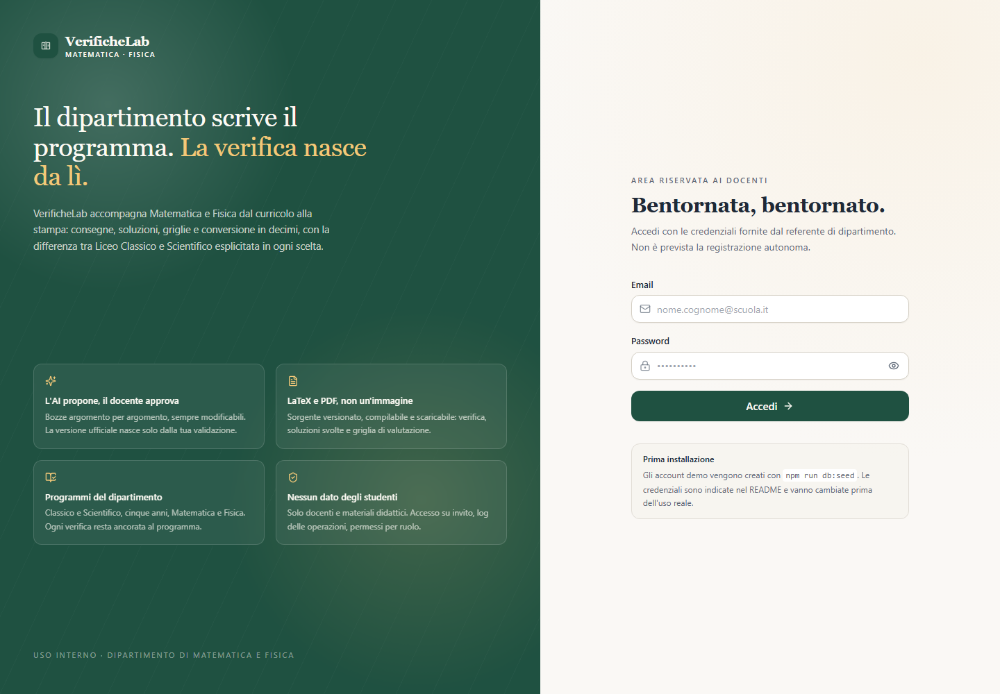
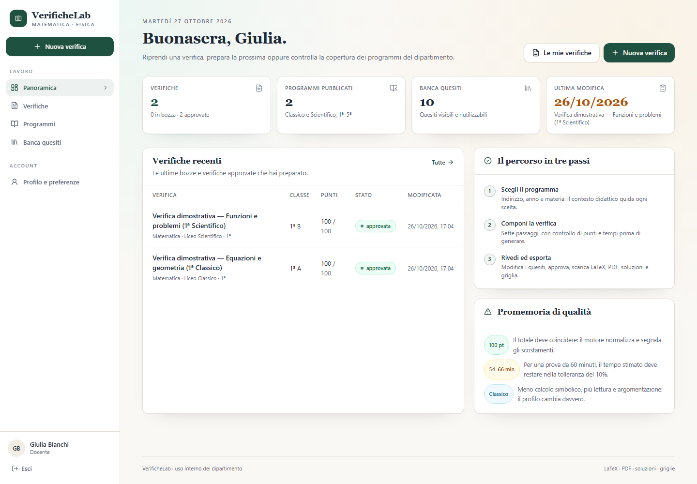
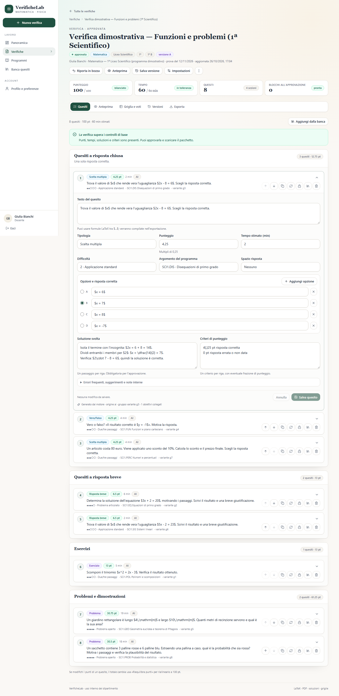

# Guida per i docenti

Questa guida descrive l'uso quotidiano di VerificheLab. Non serve conoscere il codice: servono
credenziali, il programma del dipartimento e le proprie scelte didattiche.

> **Prima di iniziare.** L'app non contiene dati di studentesse o studenti. Non inserire nomi,
> voti individuali o informazioni personali nei testi delle verifiche o delle note.

## 1. Accedere

1. Aprire l'indirizzo fornito dal referente (in locale <http://localhost:3000>).
2. Inserire email e password ricevute.
3. La prima volta cambiare la password da **Profilo** (in basso nella barra laterale).

Non esiste registrazione autonoma. Se non si hanno credenziali, il referente deve creare un
account o un invito da **Amministrazione → Utenti**.

## 2. La dashboard

La dashboard mostra:

- le ultime verifiche, con punti e minuti;
- quante sono in bozza e quante approvate;
- i programmi pubblicati disponibili;
- la banca quesiti condivisa;
- il collegamento rapido per iniziare una nuova verifica.

## 3. Consultare i programmi

**Programmi** raccoglie i curricoli per indirizzo (Classico/Scientifico), anno (1–5) e materia
(Matematica/Fisica). Un programma è composto da **argomenti** e **obiettivi operativi**.

- **Pubblicato**: usabile per generare; non modificabile (si crea una nuova versione).
- **Bozza**: modificabile dall'autore e dall'admin.
- **Archiviato**: conservato per storico, non selezionabile.

### Importare un programma

1. **Programmi → Nuovo programma**.
2. Scegliere indirizzo, anno, materia e titolo.
3. Incollare il testo oppure caricare `.txt`, `.md`, `.docx` o `.pdf` (max 12 MB).
4. Avviare l'importazione: si ottiene una **bozza** con argomenti, obiettivi, codici e pesi.
5. Rivedere tutto: l'import assistito è un punto di partenza, non una verità. Correggere titoli,
   codici, obiettivi e pesi; eliminare ciò che non appartiene al programma reale.
6. **Pubblica** solo dopo la revisione.

> I contenuti demo sono segnaposto dichiarati: **non** sono programmi ministeriali.

## 4. Creare una verifica: il wizard

**Nuova verifica** apre sette passaggi.

### Passaggio 1 — Contesto

Titolo, indirizzo, anno, materia, classe/etichetta e data. La classe è un'etichetta libera: non
inserire nomi di studentesse o studenti.

### Passaggio 2 — Programma e argomenti

Scegliere un programma **pubblicato** e selezionare uno o più argomenti. Il peso indica quanto
conta un argomento nella distribuzione dei quesiti.

### Passaggio 3 — Struttura e tipologie

Numero di quesiti e tipologie: scelta multipla, vero/falso, risposta breve, risposta aperta,
esercizio, problema, grafico, analisi dati, dimostrazione. Opzioni: problema lungo, domande di
teoria, calcolatrice, formulario, tavole trigonometriche.

### Passaggio 4 — Punti e durata

Impostare totale (default 100) e durata (default 60 minuti). Il rule engine porta i punteggi a
multipli di 0,25 e i tempi a minuti interi, rispettando il totale e la tolleranza del ±10%.

### Passaggio 5 — Difficoltà e opzioni

Difficoltà media 1–5, lingua semplificata, solo definizioni, niente derivate, spazio risposta,
numero di varianti (A–D) e criterio di variazione (numeri, ordine, domande).

### Passaggio 6 — Riepilogo

Controllare la richiesta e la stima di costo/tempo. Se qualcosa non convince, tornare indietro:
nessun dato viene perso.

### Passaggio 7 — Generazione

Avviare la generazione. L'app propone una bozza e apre l'editor. In caso di errori, mostra un
messaggio comprensibile e non perde la configurazione.

## 5. L'editor

Le schede in alto:

- **Quesiti** — modifica testo, opzioni, punti, difficoltà, tempo, soluzione, criteri, errori
  comuni, suggerimenti. Azioni: rigenera quesito, duplica, salva in banca, sposta su/giù.
- **Anteprima** — PDF se il motore LaTeX è disponibile, altrimenti HTML con KaTeX.
- **Griglia** — indicatori, livelli, mappatura quesito→indicatore, conversione in decimi.
- **Versioni** — salva un'istantanea, confronta, ripristina.
- **Esporta** — `.tex`, PDF, ZIP, JSON e log dell'ultima compilazione.

### Punti e riequilibrio

Se si modifica il punteggio di un quesito, il totale cambia. **Riequilibra** ridistribuisce punti
e tempi per tornare al totale e alla durata richiesti. I quesiti bloccati non vengono modificati.

### Riordino

Le frecce spostano il quesito all'interno della sua sezione. Ai confini il pulsante è disabilitato:
per cambiare sezione usare il selettore del quesito.

### Approvazione

Il pulsante **Approva** è attivo solo quando non ci sono errori bloccanti. Restano visibili gli
avvisi (per esempio difficoltà media lontana dal target). Il server rivalida sempre: non è
possibile approvare una verifica con soluzioni o criteri mancanti.

## 6. Esportare e stampare

1. Scheda **Esporta**.
2. Controllare l'esito dell'ultima compilazione.
3. Scaricare:
   - **Verifica** `.tex` o `.pdf`
   - **Soluzioni** `.tex` o `.pdf`
   - **Griglia** `.tex` o `.pdf`
   - **ZIP** con tutti i file e il JSON
4. Stampare il PDF della verifica; usare soluzioni e griglia per la correzione.

Il PDF riporta `Pag. X di Y`. Se un quesito non deve essere spezzato, usare l'anteprima e
aumentare lo spazio risposta o ridurre il testo.

Se la compilazione fallisce:

- il pannello mostra il log;
- il `.tex` è comunque scaricabile;
- la verifica non viene persa;
- si può correggere il testo o compilare il `.tex` su un altro computer.

## 7. Banca quesiti

**Banca** contiene quesiti riutilizzabili.

- **Privato**: solo l'autore.
- **Dipartimento**: tutti i docenti del dipartimento.
- **Pubblico interno**: tutti gli utenti autenticati.

Azioni: cercare, filtrare per materia/argomento/tipo, valutare, aggiungere a una verifica,
modificare o eliminare i propri. Dalla banca si può anche creare una nuova verifica con i quesiti
selezionati.

## 8. Versioni e varianti

- **Versione**: istantanea completa della verifica. Utile prima di modifiche importanti.
- **Variante**: copia A/B/C/D con numeri, ordine o domande differenti, per ridurre copiatura tra
  banchi. Ogni variante è una verifica separata e si esporta con il proprio nome file.

## 9. Griglia e conversione in decimi

La griglia unisce:

- indicatori (Conoscenze, Abilità procedurali, Risoluzione di problemi, Linguaggio e
  argomentazione, personalizzabili);
- livelli e descrittori;
- mappatura di ogni quesito agli indicatori;
- punteggio totale e soglia di sufficienza;
- conversione in decimi (lineare o a scaglioni).

La conversione rispetta la soglia impostata: con 100 punti e soglia 60, 60/100 = 6. Il voto è
arrotondato a 0,25. Per una scala a scaglioni, verificare che le fasce coprano 0–100 e non si
sovrappongano.

## 10. Amministrazione (solo admin)

- **Utenti**: creare account, cambiare ruolo/materie/indirizzi, disattivare, reimpostare password.
- **Inviti**: generare un link monouso (7 giorni), copiarlo e condividerlo.
- **Impostazioni**: nome istituto, logo, provider/modello AI, budget, motore LaTeX.
- **Log**: audit delle azioni, filtrabile.
- **Statistiche**: verifiche, programmi, banca, utenti.

## 11. Problemi frequenti

| Problema | Cosa fare |
| --- | --- |
| “Sessione scaduta” | riaccedere; la sessione scade dopo 30 giorni (configurabile) |
| “Permessi insufficienti” | l'operazione è riservata all'admin o all'autore |
| Non vedo un programma | deve essere **pubblicato** e dell'indirizzo/anno/materia corretti |
| L'anteprima è HTML, non PDF | il motore LaTeX non è installato: il `.tex` resta scaricabile |
| “Punteggi non coincidono” | usare un totale multiplo di 0,25 e **Riequilibra** |
| “Quesiti troppo simili” | rigenerare uno dei due o modificarne il testo |
| Import PDF senza testo | il PDF è una scansione: usare OCR o incollare il testo |
| ZIP senza un PDF | compilation fallita: aprire il `.log.txt` nel pacchetto o il pannello Esporta |

## 12. Buone pratiche

- Rivedere sempre soluzioni e criteri: l'AI propone, il docente decide.
- Non inserire dati personali di studenti.
- Salvare una versione prima di modifiche estese.
- Usare la banca per riutilizzare quesiti già validati.
- Esportare il ZIP e conservarlo con il registro del dipartimento.
- Segnalare al referente ogni errore disciplinare: i prompt e i template sono versionati.
